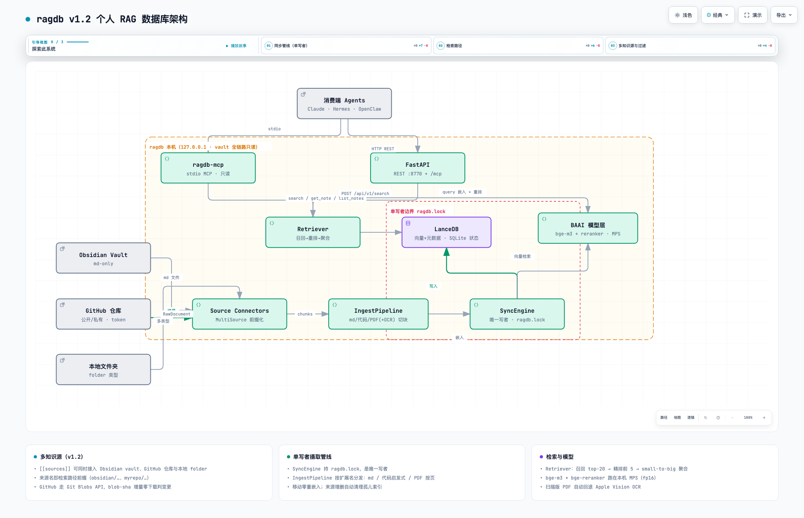

# ragdb — 个人 RAG 数据库

把知识库变成可语义检索的个人 RAG 服务：本地 BAAI 模型（bge-m3 嵌入 + bge-reranker-v2-m3 重排，Apple GPU/MPS），经 **stdio MCP / Streamable HTTP MCP / localhost REST** 三通道供 Claude、OpenClaw、Hermes 等多 agent 只读调用。



## 功能特性

- **多知识源**：`ragdb.toml` 的 `[[sources]]` 同时接入 Obsidian vault、GitHub 仓库（公开/私有）与本地任意文件夹，来源前缀化互不冲突，增删来源自动清理孤儿索引
- **多类型内容**：Markdown 按标题切块；代码文件启发式切块（符号名进标题链）；PDF 按页切块；扫描版 PDF 自动回退 **Apple Vision OCR**（本机推理）
- **检索质量**：向量召回 top-20 → 交叉编码精排前 5 → small-to-big 聚合（块检索单位、笔记返回单位、token 预算裁剪）
- **增量同步**：mtime → hash 两级对比，移动零重嵌入；GitHub 走 Git Blobs API，未变更文件零下载
- **三通道接入**：stdio MCP（Claude/Hermes/OpenClaw）· Streamable HTTP MCP（`/mcp`）· REST API，全部只读
- **隐私优先**：全链路本机运行（模型 MPS fp16、OCR 走系统 Vision 框架），vault 只读、单写者锁、无公网暴露

## 检索性能（M4 实测）

热查询 **0.7-1.2s**（含重排），模型冷加载 ~15s/进程；全项目磁盘占用 < 5GB。

## 快速开始

```bash
uv sync --extra dev                 # 安装依赖（uv 自动准备 Python 3.12）
uv run ragdb sync                   # 建索引（模型首次下载约 4.5GB，走 hf-mirror）
uv run ragdb search "你的查询"       # 命令行检索
uv run ragdb serve                  # 常驻服务（REST :8770 + /mcp + 30s 后台同步）
```

接入 Claude Code / Desktop（`mcpServers`）：

```json
{ "ragdb": { "command": "uv", "args": ["run", "ragdb-mcp"], "cwd": "<本项目路径>" } }
```

接入 Hermes：`~/.hermes/config.yaml` 的 `mcp_servers` 同上；或指向 `http://127.0.0.1:8770/mcp`。其它 agent（含无 MCP 能力的）见接入指南。

## 文档

| 文档 | 内容 |
|---|---|
| [智能体接入与操作指南](docs/智能体接入指南.md) | 给接入 agent 的完整操作手册（三通道配置、端点参考、排障） |
| [设计规格](docs/superpowers/specs/2026-09-08-rag-database-design.md) | 接口/常量/约束的唯一权威 |
| [ragdb.toml](ragdb.toml) | 全参数带语义备注的配置文件 |
| [架构图](docs/diagrams/ragdb-architecture.html) | 可交互 HTML（暗/亮主题、缩放、关系追踪） |
| [项目配置清单](项目配置清单.md) | 环境事实与已知坑 |

## 版本演进

| 版本 | 内容 |
|---|---|
| v0.1.0 | 单源 RAG（Obsidian）+ 三通道接入 |
| v0.1.1 | 多渠道 `[[sources]]`（Obsidian + GitHub 仓库）+ blob-sha 增量 |
| v0.1.2 | 多类型内容：代码启发式切块、PDF 按页 + Apple Vision OCR、folder 来源、`[ingest]` 过滤 |

## 开发

```bash
uv run pytest                       # 全量快速测试（约 8s，零模型零网络）
RAGDB_SLOW=1 uv run pytest -m slow  # 真实模型慢速测试
uv run ruff check .                 # Lint
```

测试策略与架构详见[设计规格](docs/superpowers/specs/2026-09-08-rag-database-design.md)。

## 硬约束

vault 全链路**只读**；单写者（serve 持 `ragdb.lock`）；MCP/HTTP 只读无写工具；不暴露公网。

## License

[MIT](LICENSE)
